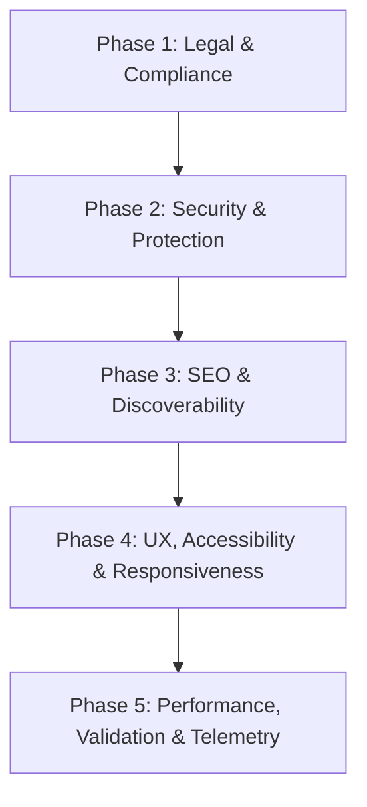

# Roadmap: Swag-flow Production Readiness (20 Features)

## Phase Structure

### Phase 1: Legal & Compliance
- [x] Task 1.1: Privacy Policy page (`/privacy`) [Item 01]
- [x] Task 1.2: Terms & Conditions page (`/terms`) [Item 02]
- [x] Task 1.3: Cookie consent banner component with consent storage [Item 05]
- [x] Task 1.4: Site footer with legal links and consent management toggle

### Phase 2: Security & Protection
- [ ] Task 2.1: Audit client bundle & environment variables to ensure zero secret leakage [Item 03]
- [ ] Task 2.2: Enforce HTTPS, HSTS, CSP, and security response headers in `next.config.ts` [Item 04]
- [ ] Task 2.3: Anti-spam and bot protection using Arcjet rate-limiting and form honeypots [Item 18]

### Phase 3: SEO, Social & Discoverability
- [ ] Task 3.1: Complete meta titles, descriptions, and OpenGraph/Twitter tags [Item 06]
- [ ] Task 3.2: Custom OpenGraph social preview image (`app/opengraph-image.tsx` or static OG) [Item 07]
- [ ] Task 3.3: Favicon and web app manifest set [Item 08]
- [ ] Task 3.4: Dynamic `sitemap.ts` and `robots.ts` routes [Item 09]

### Phase 4: UX, Accessibility & Design Integrity
- [ ] Task 4.1: Audit and add descriptive `alt` text to all images and SVGs [Item 10]
- [ ] Task 4.2: Audit and fix WCAG AA color contrast (rust accent on coffee background) [Item 13]
- [ ] Task 4.3: Mobile responsiveness polish across arena, leaderboard, and models [Item 14]
- [ ] Task 4.4: Branded custom 404 page (`app/not-found.tsx`) [Item 15]
- [ ] Task 4.5: Broken link check and navigation audit [Item 16]
- [ ] Task 4.6: Single clear primary Call-To-Action (CTA) per page [Item 20]

### Phase 5: Performance, Validation & Telemetry
- [ ] Task 5.1: Image compression and next/image optimization [Item 11]
- [ ] Task 5.2: Page load speed optimizations (code splitting, font preconnect) [Item 12]
- [ ] Task 5.3: End-to-end form validation (Zod schema on client & API) [Item 17]
- [ ] Task 5.4: Analytics setup and event telemetry verification (Statsig / PostHog) [Item 19]
